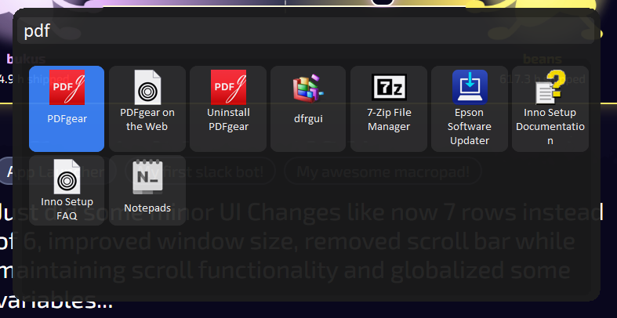

# App-Launcher(Python)
Windows App Launcher. Run the App Launcher from start menu and whenever u press Alt+X, It would pop-up. Very less CPU and Memory Usage

I made it because existing launchers use way too much resources and my laptop doesn't have that many to give so this runs efficiently and is LITTERALY INSTANT (faster than Start, you may check) and solves my purpose...
Its made fully in Python and uses CustomTkinter for GUI. It is a very simple app but it does the job well.
I used Python because its easy to make an app in and not very resource demanding always...

I used many libraries to make this app, some of them are:
1. Tkinter
2. CustomTkinter
3. Pynput
4. Pywin32
5. Rapidfuzz
6. Pillow
7. Win32gui, win32con, win32api, win32print
8. ctypes
9. subprocess
10. os
11. sys
12. json
13. time
14. queue
15. threading

At start i used VS Code but then moved to IntelliJ IDEA... I also used Pyinstaller to make the .exe and Inno Setup to make the setup file. I also used GitHub to host the code and releases(On which you currently are on :) )
### Hotkey to Launch is Alt+X
When u start the app, it would start as a background process, nothing would be visble. The app would become visible when u press Alt+X




## [Download Setup](https://github.com/SpaceCoderPro/App-Launcher/releases)

### If u find any issues, plss report them in the issues tab so I can follow up...

## Compilation Instructions for .exe
Download all files in the Pyinstaller folder then run the below commands
```
pyinstaller --noconsole "App Launcher.pyw"
```
## To run with python installed on your computer
Download all files in the root folder then run "App Launcher.pyw"

## Libraries to Install
```
pip install tkinter pynput pywin32 rapidfuzz
```
